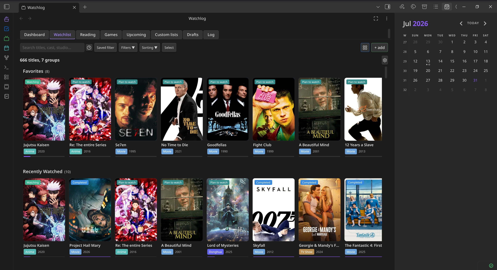
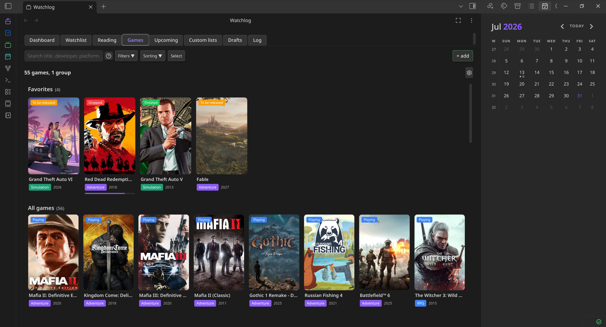
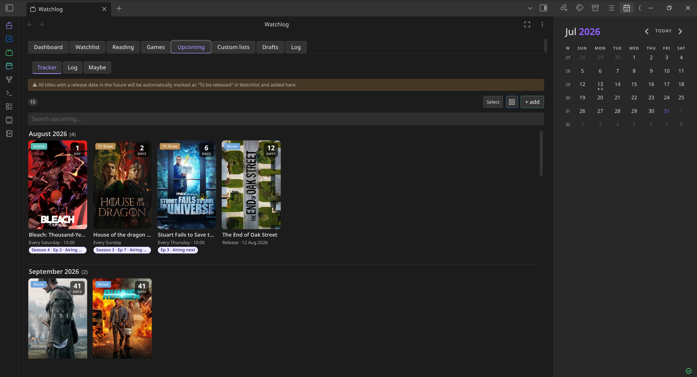
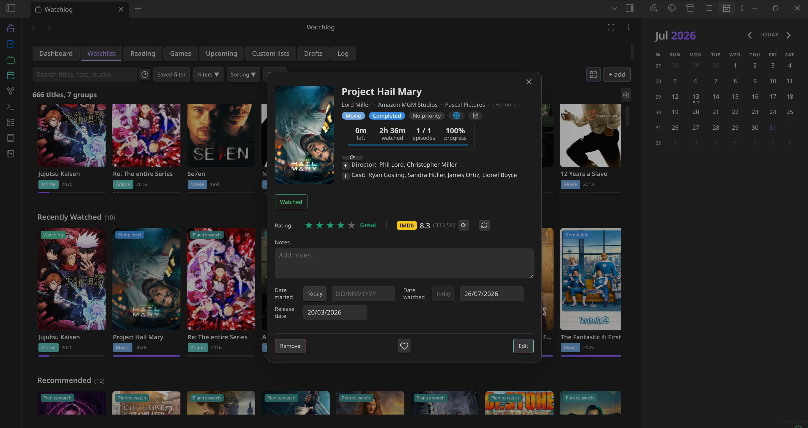
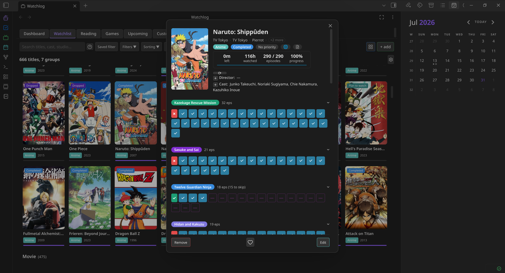
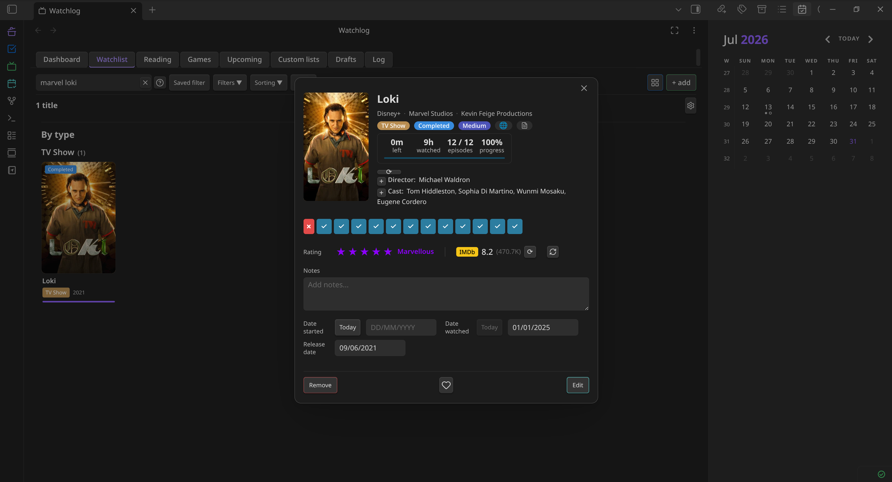
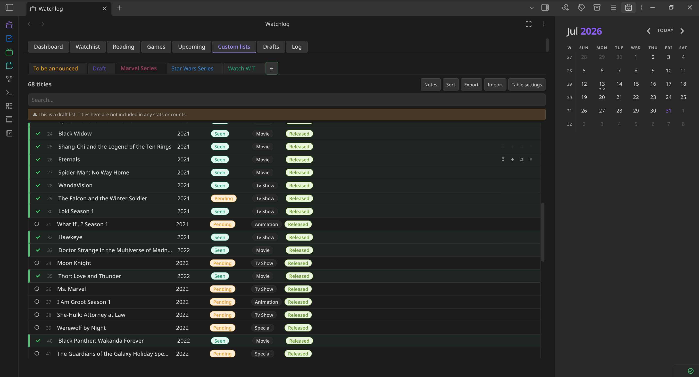

# WatchLog Sync

Track anime, movies, TV shows, books, manga and games in one place — as notes in your vault, on
every device.

This is a fork of [WatchLog](https://github.com/Shynkro/watchlog-obsidian-plugin) by BogdanS. The
original keeps all tracked data in the plugin's `data.json`, which does not travel between devices
(see [upstream issue #24](https://github.com/Shynkro/watchlog-obsidian-plugin/issues/24)). This fork
moves the data into the vault so that Obsidian Sync, Syncthing, Git, Remotely Save and friends sync
it like any other note. UI and features are otherwise the same.

WatchLog Sync adds a sidebar panel with eight tabs:

- **Dashboard** — progress rings, time watched/remaining, library stats across all four libraries.
- **Watchlist** — titles and groups with per-episode tracking, seasons, skipped episodes, community ratings (IMDb / MAL / AniList / TMDB), studios, cast and directors.
- **Games** — status, completion %, playtime, platforms, wishlist, groups, optional Steam library sync.
- **Reading** — books (pages or words) and manga (chapters, volumes), quotes pulled from your notes, custom columns.
- **Upcoming** — release schedules with recurrence, countdowns and desktop notifications.
- **Custom Lists** — freeform Markdown-backed tables that can auto-pull remaining watch time.
- **Drafts** — scans your vault for a tag (default `#watchlog`) and turns those lines into entries.
- **Log** — a unified activity timeline of everything you add, finish, rate or delete.

Inline code-block widgets (`wl-todo`, `wl-stat`, `wl-upcoming`, `wl-nowwatching`, `wl-now-next`)
render live progress anywhere in your notes. Desktop and mobile.

---

### Where your data lives

Everything you track is a Markdown note with YAML frontmatter, under one root folder (default
`WatchLog/`, one subfolder per type). The notes are the source of truth: edit the frontmatter by
hand, on any device, and the plugin picks it up.

| What | Where | Synced |
|---|---|---|
| Entries (titles, books, manga, games), progress, ratings, groups | notes in the root folder | yes |
| Activity log | `History.md` in the root folder | yes |
| Shared settings: types, statuses, priorities, custom columns, API mapping | `WatchLog.base` in the root folder (`watchlog:` block) | yes |
| API keys, Steam id, cached API data, colors, layout, saved filters | `data.json` of the plugin | no, per device |

Set up a second device by syncing the vault and installing the plugin. It finds the base file,
reads the notes and is ready; only API keys have to be entered again.

### Coming from the original WatchLog

Install WatchLog Sync next to the original and start Obsidian once. If this plugin has no data of
its own yet, it reads the original's `data.json`, writes a `data.v1-backup.json` beside it and
converts everything into notes. Existing notes are never overwritten, and a second device with the
same old data adds nothing twice. Afterwards you can disable the original plugin.

The same conversion runs for a JSON backup restored via **Settings → General**.

---

### Set up the APIs

This is the only real setup step. Everything works manually without a key, but APIs are what fill in
posters, covers, episode counts, release dates and ratings for you.

Go to **Settings → WatchLog Sync → API**. Each library is a card:

- **Movies & TV shows** — pick OMDb *or* TMDB, paste the key.
- **Anime** — pick Jikan or AniList. No key needed either way.
- **Books & manga** — paste a Google Books key for books; manga always uses Jikan (no key).
- **Games** — pick RAWG *or* IGDB. Steam is optional and runs alongside, for library sync.

Each card has a **Get a key ↗** link, a **(?)** for the full instructions and a **Test** button — use
Test after pasting so you know the key works before you start adding things.

If you added your own Watchlist types, scroll to **API routing by type in Watchlist** at the bottom of
the same page and pick which service answers for each (Anime, Movie and TV Show are locked to theirs).

### Add your first entry

Use **+ add** in any tab, or the command palette. Type a name, pick a result from the search list, and
the fields fill themselves — or skip the search and type everything by hand. `#watchlog Some Movie` in
any note also queues it up in the Drafts tab.

### Worth knowing

- **Settings → Customize** — themes, card sizes and text placement, and your own types, statuses,
  priorities, genres and platforms with colors.
- **Settings → General** — date format, half-star ratings, JSON backup & restore.
- Types and statuses are shared via the base file, colors are per device: the same vocabulary everywhere, your own look on each.
- The ⋮ menu on any card has Edit, Refresh cover, Open note and Delete.

---

## Screenshots

**Watchlist** — shelves of poster cards with status badges, type colors and progress bars.

**Games** — the same layout for your library, with genres, statuses and wishlist.

**Upcoming** — releases grouped by month with countdowns and airing info.

**Title details** — studios, cast, time watched, IMDb score and notes in one modal.

**Episode tracking** — tick episodes one by one; seasons collapse and skipped episodes (dashes) stay out of your progress.

**Custom lists** — freeform tables stored as Markdown notes in your vault.

---

## APIs

| Service | Used for | Key |
|---|---|---|
| [Jikan](https://jikan.moe/) (MyAnimeList) | Anime + manga search, airing schedules, scores | Not needed |
| [AniList](https://anilist.co/) | Anime alternative to Jikan | Not needed |
| [OMDb](https://www.omdbapi.com/apikey.aspx) | Movies & TV, season episode counts, IMDb ratings | Free key |
| [TMDB](https://www.themoviedb.org/settings/api) | Movies & TV, posters, cast, studios, collections | Free read token |
| [Google Books](https://console.cloud.google.com/apis/credentials) | Book search, authors, page counts, covers | Free key |
| [RAWG](https://rawg.io/apidocs) | Game search, covers, platforms, store links | Free key |
| [IGDB](https://dev.twitch.tv/console/apps) | Game alternative to RAWG | Twitch client ID + secret |
| [Steam](https://steamcommunity.com/dev/apikey) | Import your owned games and playtime | Web API key + Steam ID |

All of them are optional and all of them are free. TMDB unlocks the most (posters, cast, studios,
film collections). Steam needs your profile's **Game details** privacy set to Public.

---

## Support the original author

WatchLog Sync builds on the work of BogdanS. If the plugin is useful to you, consider supporting the
original:

---

## License

[MIT](LICENSE) © Shynkro (BogdanS), fork © Alexander Pape
